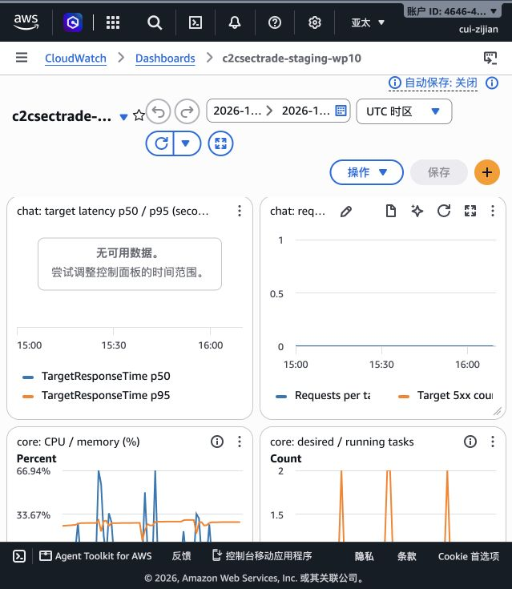

# CloudWatch historical screenshot — 14 October 2026

Captured from the authenticated AWS console on 15 October by CUI ZIJIAN.
Dashboard: `c2csectrade-staging-wp10`, region `ap-southeast-1` (5001 / ass).

Selected absolute window: **2026-10-14 15:00–16:10 UTC**, equivalent to
**14 October 23:00–15 October 00:10 Singapore**. The console accessibility
state confirmed both full timestamps; the narrow screenshot header truncates them.
This includes the failed authenticated smoke around 15:14 UTC and the pagination
retest around 15:57 UTC. See the adjacent staging test reports for precise k6 results.

## What this evidence shows

- Chat target latency reports no available data. Missing data is not zero latency.
- The captured viewport shows chat request/error graphs and only the upper portions
  of Core CPU/memory and desired/running-task graphs.
- Task-count fluctuations are visible, but their cause and exact values are not
  established by this partial view. Deployment replacement is not distinguished
  from scaling activity here.

## Limits

This is one unmodified console viewport screenshot, not a full dashboard capture
or raw metric export. Core chart bottoms/legends and Search graphs are not captured.
Do not derive numeric CPU/memory summaries, fixed task counts, scaling policy state,
or a successful 1-to-4 autoscaling test from it. No 200-VU capacity result is claimed.
CloudWatch's aggregated historical charts also do not isolate a 30-second k6 run.

Remaining evidence: full service charts or timestamped metric exports, ECS task and
image details, scaling policies/activity history, and matched fixed/scaling load runs.
No dashboard definition or infrastructure setting was changed during this capture.
